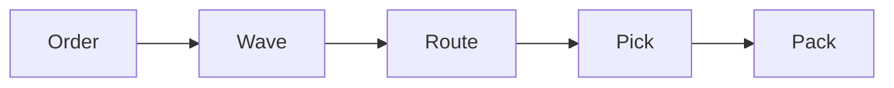

# Pick route v2

Faster picking for **wave 14**: the route now follows the aisle order.

## Flow

## Checklist

- [x] Aisle order from the location table
- [x] Skip empty bins
- [ ] Weekend shift test

| Zone | Bins | Avg pick (s) |
|------|-----:|-------------:|
| A    |  420 |          9.1 |
| B    |  388 |         11.4 |

Math for the route cost: $c = \sum_{i} d(b_i, b_{i+1})$
