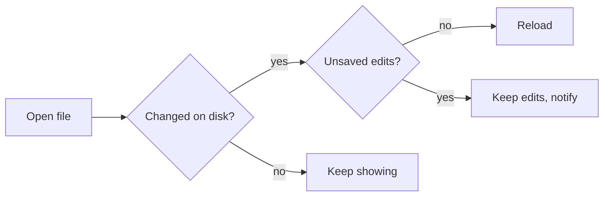
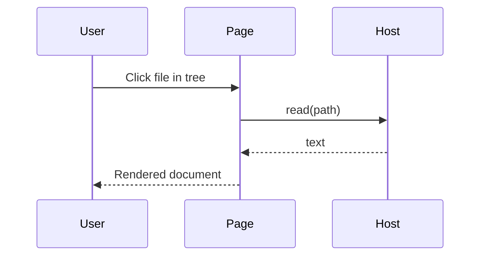
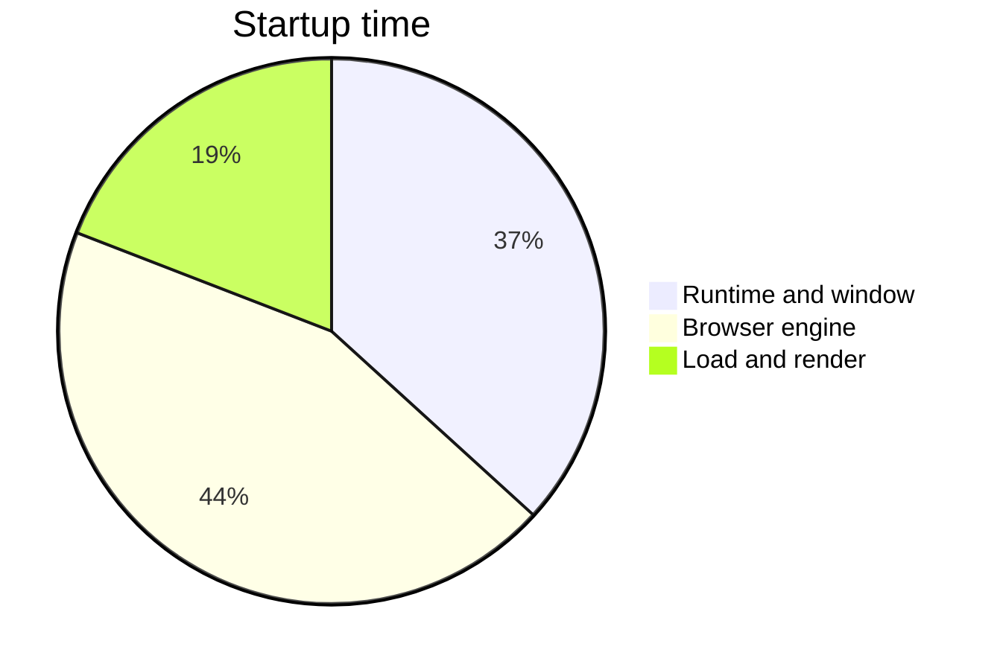

# LexPen formatting demo

This file shows everything LexPen can render. Switch to **Split** (<kbd>Ctrl</kbd>+<kbd>E</kbd>) to see
the source next to the result. The block above this heading is YAML front matter.

**Contents:** [Text](#text-styles) · [Lists](#lists) · [Links and images](#links-and-images) ·
[Quotes and alerts](#quotes-and-alerts) · [Code](#code) · [Tables](#tables) · [Math](#math) ·
[Diagrams](#diagrams) · [HTML](#raw-html) · [Footnotes](#footnotes-and-definitions)

---

## Text styles

Plain text, **bold**, *italic*, ***bold italic***, ~~strikethrough~~, ==highlighted==, and `inline code`.

Subscript H~2~O and superscript E = mc^2^. Emoji shortcodes: :rocket: :sparkles: :white_check_mark: :warning: :memo:

A line ending in two spaces  
breaks without starting a new paragraph. Special characters can be escaped: \*not italic\*, \# not a heading.

# Heading 1
## Heading 2
### Heading 3
#### Heading 4
##### Heading 5
###### Heading 6

## Lists

Unordered, nested:

- Fruit
  - Apple
  - Pear
    - Conference
    - Doyenné
- Vegetables
- Bread

Ordered, with nested content:

1. Install the tools
2. Build the project
   1. Restore packages
   2. Compile
   3. Publish
3. Run it

   A paragraph and a code block can live inside a list item:

   ```powershell
   dotnet publish -c Release -o publish
   ```

Task list:

- [x] Render markdown
- [x] Edit with syntax highlighting
- [x] Day and night theme
- [ ] World domination

## Links and images

- Web link: [Markdown guide](https://www.markdownguide.org) (opens in your browser)
- Link with a title: [CommonMark](https://commonmark.org "The CommonMark specification")
- Bare URLs are linked automatically: https://github.com
- Jump inside the document: [back to the top](#lexpen-formatting-demo)
- Reference-style link: [the spec][spec]

[spec]: https://spec.commonmark.org

A local image, relative to this file:


The same image sized with HTML, next to the other icon designs:


## Quotes and alerts

> A blockquote can span several lines
> and contain **formatting**.
>
> > Quotes can be nested.

> [!NOTE]
> Useful information the reader should know.

> [!TIP]
> Helpful advice for doing things better.

> [!IMPORTANT]
> Key information needed to succeed.

> [!WARNING]
> Urgent information that needs attention.

> [!CAUTION]
> Advises about risks or negative outcomes.

## Code

Inline: call `render()` after `setText(text)`.

```csharp
// C#
public sealed record Document(string Path, string Text)
{
    public bool IsMarkdown => Path.EndsWith(".md", StringComparison.OrdinalIgnoreCase);
}
```

```javascript
// JavaScript
async function openFile(path) {
  const text = await host('read', { path });
  return text.split('\n').length;
}
```

```python
# Python
def fibonacci(n: int) -> list[int]:
    a, b, out = 0, 1, []
    while len(out) < n:
        out.append(a)
        a, b = b, a + b
    return out
```

```sql
SELECT name, COUNT(*) AS documents
FROM files
WHERE extension = '.md'
GROUP BY name
ORDER BY documents DESC;
```

```json
{ "name": "LexPen", "light": true, "themes": ["day", "night"] }
```

```diff
- const slow = await lookup('lexpen.example');
+ const fast = resolveLocally('lexpen.example');
```

```
A code block without a language stays plain.
```

## Tables

| Feature              | Supported | Notes                         |
| :------------------- | :-------: | ----------------------------: |
| Tables               |    ✅     |        left, centre and right |
| **Formatting** cells |    ✅     |       `code`, *italic*, links |
| Task lists           |    ✅     |                               |
| Diagrams             |    ✅     |                       Mermaid |

## Math

Inline math sits in the text: $e^{i\pi} + 1 = 0$ and $a^2 + b^2 = c^2$.

Block math gets its own line:

$$
x = \frac{-b \pm \sqrt{b^2 - 4ac}}{2a}
$$

$$
\int_0^\infty e^{-x^2}\,dx = \frac{\sqrt{\pi}}{2}
\qquad
\sum_{k=1}^{n} k = \frac{n(n+1)}{2}
$$

$$
A = \begin{pmatrix} 1 & 2 \\ 3 & 4 \end{pmatrix}
$$

## Diagrams

Flowchart:



Sequence diagram:



Pie chart:



## Raw HTML

<details>
<summary>Click to expand a collapsible section</summary>

Hidden content, with **markdown** inside.

</details>

Keyboard keys: <kbd>Ctrl</kbd>+<kbd>S</kbd> saves, <kbd>Ctrl</kbd>+<kbd>T</kbd> switches theme.

<p align="center"><em>Centered text using HTML.</em></p>

## Footnotes and definitions

Markdown was created by John Gruber[^gruber] and later standardised as CommonMark[^cm].

Markdown
: A lightweight markup language for writing formatted text in a plain text editor.

LexPen
: A lightweight viewer and editor for it.
: A term can have more than one definition.

---

*End of the demo.*

[^gruber]: Published in 2004 together with Aaron Swartz.
[^cm]: A strict, unambiguous specification of the syntax.
