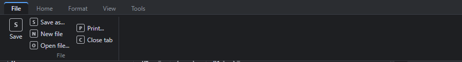
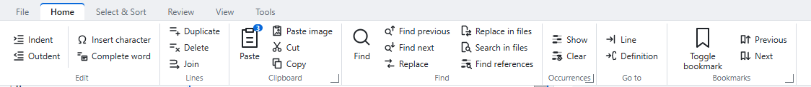
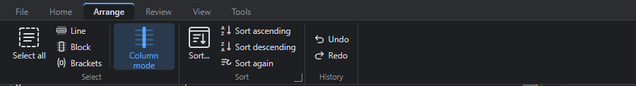
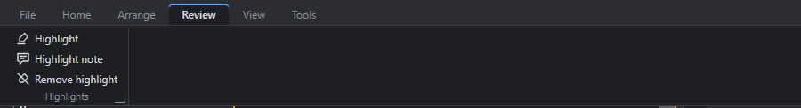
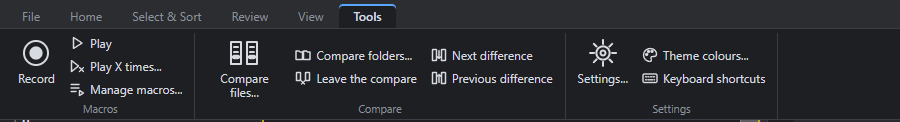
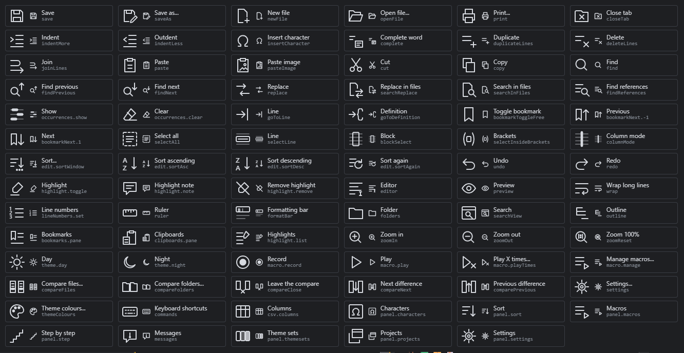
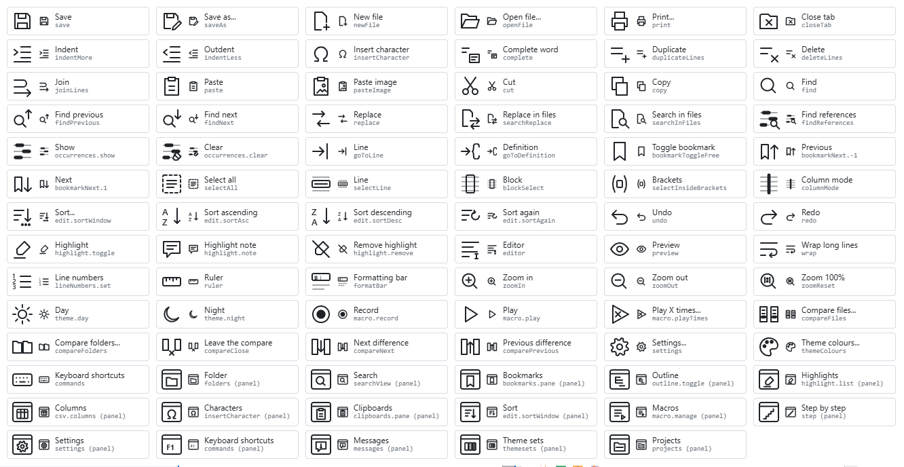

# Plan: A ribbon with the actions each user wants at hand

Status: draft 2026-11-07, revised 2026-11-08 (many times); not started. From plan 25 (executed/PLAN-menu-structure.md 3.7), where
it was proposed. The number in the file name is the priority; rename to reorder.

## 1. What this is about

Everything LexPen does is in the menus and F1, and the actions used most have keys. But a key has to be known and a
menu item has to be found: there is no row of buttons for the actions a user reaches for all the time (save, undo,
find, the panels, record a macro). Every user has other favourites, so a fixed toolbar would suit nobody: the user
must be able to choose what is on it.

## 2. The solution, in brief

An optional ribbon under the menu bar, with tabs (File, Home, Arrange, Review, View, Tools); each tab holds named groups of
buttons, each button running an action as its menu item does, its tooltip showing the title and the key. A button is
large (icon above its label, the ribbon's full height) or small (icon with its label beside it), and up to three
small buttons stack in the height of one large one. A group may have a small icon in each bottom corner that opens its
manager (Clipboards, Bookmarks, Highlights, stored sorts) or bar (Occurrences). LexPen ships a first set; the user adds, removes and orders
tabs, groups, buttons and dividers through Customize, kept in a `ribbon.json` in the data folder as `keys.json` is.
A setting chooses what the window shows: the menu bar, the ribbon, or both; another whether group names are shown.

## 3. Details

### 3.1 The shipped content

Per tab its groups, left to right; per group its columns, left to right. A column is one large button, two or three
small buttons stacked (the first on top), one small button alone, or a divider. Between groups there is always a
divider. "Corner": the action of the group's corner icon, bottom right; bottom left is free in the shipped ribbon.

**File**

| Group | Columns |
|---|---|
| File | Save (large) / Save as... + New file + Open file... / Print... + Close tab |

**Home**

| Group | Columns |
|---|---|
| Edit | Indent + Outdent / divider / Insert character + Complete word |
| Lines | Duplicate + Delete + Join (Duplicate lines, Delete lines, Join lines) |
| Clipboard | Paste (large; a number badge: the active clipboard) / Paste image + Cut + Copy. Corner: Manage clipboards |
| Find | Find (large) / Find previous + Find next + Replace / Replace in files + Search in files + Find references |
| Occurrences | Show + Clear (Show all occurrences, Clear occurrences). Corner: Occurrences field (the bar opened, the cursor in its field) |
| Go to | Line + Definition (Go to line, Go to definition) |
| Bookmarks | Toggle unnumbered bookmark (large) / Previous + Next (Previous bookmark, Next bookmark). Corner: Manage bookmarks |

**Arrange**

| Group | Columns |
|---|---|
| Select | Select all (large) / Line + Block + Brackets (Select line, Select a block, Select inside brackets) / divider / Column mode (large, a toggle) |
| Sort | Sort... (large) / Sort ascending + Sort descending + Sort again. Corner: the Sort panel's stored sorts |
| History | Undo + Redo |

**Review**

| Group | Columns |
|---|---|
| Highlights | Highlight + Highlight note + Remove highlight. Corner: Highlights window |

**View**

| Group | Columns |
|---|---|
| Document | Editor (large, a toggle) / Preview (large, a toggle) |
| Text | Wrap long lines (large, a toggle) / Line numbers (its choices) + Ruler + Formatting bar |
| Files and finding | Folder + Search + Bookmarks |
| The document | Outline + Highlights + Columns (CSV) |
| Editing | Characters + Clipboards + Sort |
| Macros | Macros + Step by step |
| LexPen | Settings + Keyboard shortcuts + Messages / Theme sets + Theme colours + Projects (Manage projects) |
| Window | Zoom in + Zoom out + Zoom 100% / divider / Day (large) / Night (large) |

**Tools**

| Group | Columns |
|---|---|
| Macros | Record / stop recording (large) / Play + Play X times.... Corner: Manage macros |
| Compare | Compare files... (large) / Compare folders... + Leave the compare / Next difference + Previous difference |
| Settings | Settings... (large) / Theme colours... + Keyboard shortcuts and commands |

- **Actions**: all exist now (actions.js), except these new ones: **Sort again**, the last sort again with its keys
  and options (from the Sort panel or a stored sort), on the selection or the file as Sort; **Clear clipboard**, the
  active clipboard emptied; and **Paste from**, **Copy to** and **Cut to**, each with a number (0: the Windows
  clipboard, 1 to 9): from or to that clipboard once, the active one staying as it is (the lists of 3.2). Copy, Cut
  and Paste themselves stay on the active clipboard, as now.
- **Highlight** is not a toggle: it highlights the selection, or removes the highlight the cursor is in.
- **Position back / forward** (the cursor's jumps in the document) and **Back / Forward in the window** (the tabs
  and files, as a browser) are not on the ribbon: in the menus and on their keys and mouse buttons.
- **Occurrences**: the occurrences of a word without the bar. Show all occurrences takes the selection, else the
  word at the cursor, into the bar's field and marks them, and never opens the bar, whatever the setting Show the
  Occurrences bar says (a change: today it opens the bar as that setting says; a bar closed was closed by the user,
  and the corner icon opens it); Clear empties the field and the marks, also with the bar hidden (as now). The corner icon opens the bar with the cursor in its field, to type something else. The bar
  closes by its X or Esc in its field.
- **The panels**: View has every panel of Window > Panels, in its groups and order (Files and finding, The
  document, Editing, Macros, LexPen), each a show / hide toggle as there; a panel added later joins its group in both.
  Theme colours (plan 41's window) is a panel too: it joins Window > Panels' LexPen group, after Theme sets.
- **Manage ...**: every Manage (clipboards, bookmarks, macros) and the other managers (the Highlights window, the stored
  sorts, the Occurrences bar) are a group's corner icon, not a button.
- **Editor and Preview** are not on Home: they are the switches at the window's top right, and View > Document.
- **History** (Undo, Redo) is on Arrange: Home has room for it, but need not fill the window.
- **Day / Night**: the two values of Day / night, each its own button, the current one pressed.
- **Width**, measured in a mock (a test copy, LexPen's own font and the Dark theme, group names on, the icons of
  3.4, a 1264 px wide window): File 239 px, Home 1104 px, Arrange 507 px, Review 146 px, View 1222 px, Tools
  758 px. Home's groups: Edit 216, Lines 96, Clipboard 156, Find 279, Occurrences 75, Go to 98, Bookmarks 179; the
  ribbon 120 px high with its tabs. Every tab fits that window; a narrower one sends Home's right end into the ">>"
  menu.

The mock, per tab, with the icons of 3.4 (the corner icon at the bottom right of Clipboard, Occurrences, Bookmarks,
Sort, Highlights and Macros); Home also in the light theme:

### 3.2 Behaviour

- **A button is an action**: it runs the action (actions.js) with its value, like a menu item; its tooltip is the
  action's title and key. Its label is the action's title, or a shorter one of its own where the group says the
  rest ("Line" in Select for Select line). A toggle shows pressed when on (Wrap, Column mode, the panels); a button whose action is
  not available now is greyed out (the action's `enabled`). An action with choices (Line numbers) opens them as a
  small menu.
- **Tabs**: a row of tab names on top; a click shows that tab's groups. The tab last shown is kept per window. The
  ribbon's height is the same on every tab: three small rows, or one large button.
- **Sizes**: large: the icon above the label, the full height. Small: the icon with its label beside it, a third of
  the height. A small button marked "stacked" goes under the small button before it in the same column; at most
  three per column. A small button not stacked starts a new column; a column of one or two small buttons has them
  centred in the height.
- **Tooltips**: every button and corner icon shows its action's title and key when the mouse is over it (a button
  with a short label: the full title, Go to line for Line).
- **Numbered lists: a split button.** A button whose action works on one of several numbered things gets a small
  arrow (a large button: under its label; a small one: at its right); the arrow, and a right-click outside change
  mode, open the same list as its menu, and the button shows which one is in use:
  - **Paste**: its badge is the active clipboard's number (none for the Windows clipboard). Its list: Paste from
    each clipboard (the Windows clipboard and 1 to 9, each with the start of its text): that one once, the active
    one staying; then "Active clipboard" with the same clipboards, the active one checked, a choice making it active
    (the badge follows; as Edit > Clipboards); then Clear clipboard and Manage clipboards.
  - **Copy** and **Cut**: Copy to / Cut to each clipboard (the Windows clipboard and 1 to 9, the start of what is in
    it now): that one once, the active one staying.
  - **Toggle bookmark**: the list is Go to > Bookmarks' numbered ones: Toggle, Go to and Clear per number (1 to 9,
    each with its line when set), then Manage bookmarks.
  - An action of your own with numbered choices (a macro's numbered actions, later) gets the arrow the same way:
    the action says it has a list, not the ribbon.
- **The corner icons**: a group may name an action for each bottom corner (`corners: { left, right }` in
  ribbon.json); a small icon in that corner runs it, the group's name between them, as Word's dialog launcher (Manage clipboards, Manage bookmarks, Manage macros, the Highlights window,
  the stored sorts, the Occurrences bar with the cursor in its field).
- **Dividers**: a divider can stand between columns in a group; between groups always.
- **Group names** (setting ribbonGroupNames, on by default): on, the name under each group (the ribbon a line
  taller); off, one compact block: dividers only, the group's name as the tooltip of its divider.
- **Overflow**: columns that do not fit go into a ">>" menu at the right end, in their order; a group that does not
  fit at all goes there as a submenu.
- **Menu, ribbon or both** (setting commandBar: `menu`, `ribbon` or `both`; `menu` by default). The top bar (the
  file name, Stop recording, Save, the panes' orientation, Editor / Preview, Day / night, the zoom) stays in every
  case; only its menu part changes:
  - `menu`: the menus in the top bar, as now; no ribbon.
  - `ribbon`: the ribbon's tab names in the top bar, in the menus' place; its buttons under the top bar. What Alt
    does is a setting of its own, shown in Settings only with `ribbon` (setting altOpens: "Alt opens"): `tips`
    (Ribbon key tips, the default; below) or `menu` (the menus in the tab names' place until a menu closes). A
    command that is in no tab stays reachable by its key, by F1's list of every command, or by adding it (Customize).
  - `both`: the menus in the top bar; under it the ribbon, its tab names in a row of their own above its buttons.
  View > Ribbon switches between `menu` and `both`; the ribbon's own right-click has Customize..., Reset and the
  three choices.
- **Key tips** (Alt with `ribbon` and altOpens `tips`): a small letter on each tab name; its letter opens that tab
  and shows a letter on each of its buttons, and on each group's corner icons; a button's letter runs it, as a click.
  Esc goes a level back (the buttons' letters to the tabs', then off); a click elsewhere or another key ends them.
  The letters come from the names as the menus' underlined letters do (the first letter of the name no other one at
  that level has; two letters when one is not enough), so they stay the same while the ribbon does; a button may
  have a letter of its own (`tip` in ribbon.json). With `menu` and `both`, Alt opens the menus as now.
- **The format bar** stays the document's own bar above the text: the ribbon is the window's.

### 3.3 Customize

The ribbon is the user's: everything on it can be changed, on the ribbon itself, but only in its change mode, so it
never changes by accident while working.

- **Change mode**: started from the ribbon's right-click (Change the ribbon) or from the F1 window (a button
  there); ended by Done (on the ribbon) or Esc. While it lasts the ribbon is marked as being changed (a dashed edge,
  "Done" at its right end), its buttons do not run their actions, F1's list of commands is open beside it as the
  source of actions, and the "New..." places show. Starting it from F1 keeps F1 open; from the right-click it opens
  F1.

- **On the ribbon**: drag an action from F1's list of commands onto the ribbon (where it lands: before, after or
  stacked under the button it is dropped on, or into an empty spot of a group); drag a button to another place, group
  or tab (on a tab name: that tab opens, so it can be dropped there); drag a button off the ribbon to remove it.
- **Groups**: in change mode each group has a handle (a grip at its left edge, beside its name); dragging it moves the
  whole group to another place, or onto a tab name into that tab; dragged off the ribbon, the group is removed. A tab
  is dragged by its name.
- **The corners**: in change mode both corners of a group show, an empty outline where there is no action; an
  action dropped on a corner becomes that corner's action (one there already makes room: it goes back to F1's
  list); a corner icon dragged out is removed, or dropped on another corner (of this group or another), or into a
  group as a button.
- **New...** (in change mode only): the last tab name is "New..." in italics; a click makes a new tab (its name typed in place). A group's
  last place is "New..." too, for a new group.
- **A button's right-click** (in change mode): large or small, stacked under the one above or not, its label, its key tip, the
  group's corner actions, a divider before it, Remove; a group's and a tab's: Rename, Remove, its corner actions.
- **The Customize window** (the ribbon's right-click > Customize...) remains for the same work by list, as F1:
  at the left all actions with a search, grouped as the menus; at the right the ribbon's tabs, groups and columns;
  Add, Remove, Move up / down (and drag). For the keyboard, and for a full overview.
- An action with values (Preview place, a bookmark number) is added with its value, as keys.json writes
  `["preview.left"]`.
- Undo: Ctrl+Z in change mode takes the last change back; Reset: back to the shipped content.
- `ribbon.json` in the data folder: `{ "tabs": [ { "name": "Home", "groups": [ { "name": "File", "corners": { "right": "..." }, "items": [ { "action":
  "save", "size": "large" }, { "action": "selectLine", "label": "Line" }, { "action": "saveAs", "size": "small" }, { "action": "newFile", "size": "small",
  "stack": true }, { "action": "openFile", "size": "small", "stack": true }, "divider", ... ] } ] } ] }`. An action that no longer exists is skipped, not an error; a "stack"
  without a small button before it starts a column of its own.

### 3.4 Icons

- **One drawing per action, two sizes**: every button can be small or large (the user changes the ribbon), so every
  icon exists in both. One drawing on LexPen's 16-unit grid, as the formatting bar's icons (format.js ICONS):
  small 16 px with lines of 1.4, large 32 px with lines of 1.0 (2 px on screen), so both are crisp; a size can get
  a drawing of its own later where the small one loses detail.
- **Light and dark: one set.** The icons are drawn in the text colour (`currentColor`), so they follow the theme:
  dark lines on a light theme, light lines on a dark one, with nothing to keep in step. Two sets would only be
  needed for coloured icons; a colour, where one helps later (Record red, say), comes from the theme's own colours
  (`caution`, `accent`), not from a second set.
- **The proposal**: an icon for every button of 3.1 (the panels included), in `39-PLAN-ribbon.md.images/ribbon-icons.js` (per action its
  label and its drawing). The mock uses them. Below: all of them, large and small, in the dark and the light theme.
- **Related actions share a drawing**: Find references and Clear are Show's marked text with a magnifier or an
  eraser in its corner; Sort again is Sort...'s lines with a circular arrow where its arrow down is; Play X times is
  Play with an X inside.
- **Panels**: a panel's icon is a small window (a frame with a title bar) with the panel's drawing inside, so a
  panel button reads as "a window opens"; a button that opens a panel has the panel's icon wherever it stands
  (Tools: Settings..., Theme colours..., Keyboard shortcuts). At 32 px the drawing is the panel's own at 0.66; at 16 px a simpler one
  drawn for that size, about a pixel from the frame (shrinking the large one leaves too little). Keyboard shortcuts as
  a panel shows "F1"; Messages is an empty balloon.
- An action without an icon (one added later through Customize) shows a box with its first letter until it gets one.

### 3.5 How

- A bar element under the menu bar in index.html, built from `ribbon.json` (read through the host, as keys.json):
  the tab row, and per tab its groups as a CSS grid of columns, each three rows high.
- The state (pressed, greyed out, the clipboard badge) is refreshed where the menus refresh theirs: on the focus
  moving, a tab changing, a setting changing.
- Customize: a WebView page of its own (as F1's commands page), talking to the window as the other tool pages do.
- The host: read and write `ribbon.json`, a default copy shipped in `defaults/`.
- The settings commandBar, altOpens (shown only with `ribbon`) and ribbonGroupNames in Settings, with the other
  settings of the window's bars.

### 3.6 Alternatives

- **One row of grouped buttons without tabs**: compact, but room for only a few groups; with tabs every group fits
  and a tab is one click.
- **A fixed toolbar**: simpler, but every user wants other buttons; the menus and keys already serve the fixed set.
- **Buttons in the top bar**: it has no room, and it holds the window's state (mode, theme, zoom), not actions.

### 3.7 Tests

- Unit (C#): `ribbon.json` read and written, a missing file giving the shipped one, an unknown action skipped, a
  "stack" without a small button before it, a fourth stacked one starting a new column.
- Unit (Jint): the columns of a group from its items (large, small, two and three stacked, dividers); the key tips
  of a tab and of its buttons (unique per level, from the names, a button's own `tip` first).
- In the test copy by script: each shipped button runs its action; toggles show their state; a button greyed out
  where its action is not available; the tabs switch and keep their choice; two stacked small buttons as high as a
  large one, and three; each corner icon runs its action and shows its title and key on hover; Paste's arrow and
  right-click list the clipboards: Paste from one pastes it and leaves the active one, Active clipboard moves the
  badge, Clear clipboard empties the active one; Copy to and Cut to fill the chosen clipboard and leave the active
  one; Toggle bookmark's
  list the numbered bookmarks; Sort again repeats the last sort; group names on and off; overflow into ">>" at a narrow window; commandBar `menu`, `ribbon` (the tab
  names in the menus' place, the rest of the top bar as it was, Alt shows the key tips: a tab's letter opens it, a button's letter runs
  it, Esc goes back; with altOpens `menu` Alt shows the menus) and `both` (the tab names under the menus); Customize adds, moves, resizes, stacks and removes a button, adds a
  tab and a divider, and the ribbon follows; on the ribbon: an action dragged from F1 lands where it is dropped,
  a button dragged to another group and off the ribbon, a group moved by its handle, an action dropped on a corner
  and a corner icon dragged out, "New..." makes a tab; outside change mode nothing can be
  dragged and no "New..." shows; change mode from the right-click and from F1, ended by Done and by Esc; Reset.

## 4. Open questions

None.
