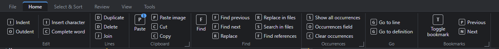
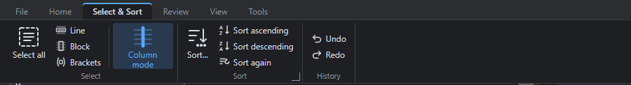
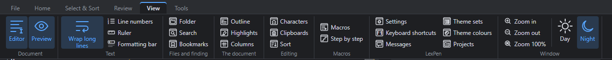

# Plan: A ribbon with the actions each user wants at hand

Status: draft 2026-11-07, revised 2026-11-08 (three times); not started. From plan 25 (executed/PLAN-menu-structure.md 3.7), where
it was proposed. The number in the file name is the priority; rename to reorder.

## 1. What this is about

Everything LexPen does is in the menus and F1, and the actions used most have keys. But a key has to be known and a
menu item has to be found: there is no row of buttons for the actions a user reaches for all the time (save, undo,
find, the panels, record a macro). Every user has other favourites, so a fixed toolbar would suit nobody: the user
must be able to choose what is on it.

## 2. The solution, in brief

An optional ribbon under the menu bar, with tabs (File, Home, Select & Sort, Review, View, Tools); each tab holds named groups of
buttons, each button running an action as its menu item does, its tooltip showing the title and the key. A button is
large (icon above its label, the ribbon's full height) or small (icon with its label beside it), and up to three
small buttons stack in the height of one large one. A group may have a small icon in its corner that opens its
manager (Clipboards, Bookmarks, Highlights, stored sorts) or bar (Occurrences). LexPen ships a first set; the user adds, removes and orders
tabs, groups, buttons and dividers through Customize, kept in a `ribbon.json` in the data folder as `keys.json` is.
A setting chooses what the window shows: the menu bar, the ribbon, or both; another whether group names are shown.

## 3. Details

### 3.1 The shipped content

Per tab its groups, left to right; per group its columns, left to right. A column is one large button, two or three
small buttons stacked (the first on top), one small button alone, or a divider. Between groups there is always a
divider. "Corner": the action of the group's corner icon.

**File**

| Group | Columns |
|---|---|
| File | Save (large) / Save as... + New file + Open file... / Print... + Close tab |

**Home**

| Group | Columns |
|---|---|
| Edit | Indent + Outdent / divider / Insert character + Complete word |
| Lines | Duplicate + Delete + Join (Duplicate lines, Delete lines, Join lines) |
| Clipboard | Paste (large; a number badge: the active clipboard) / Paste image + Cut + Copy. Corner: Manage clipboards |
| Find | Find (large) / Find previous + Find next + Replace / Replace in files + Search in files + Find references |
| Occurrences | Show all occurrences + Clear occurrences. Corner: Occurrences field (the bar opened, the cursor in its field) |
| Go to | Line + Definition (Go to line, Go to definition) |
| Bookmarks | Toggle unnumbered bookmark (large) / Previous + Next (Previous bookmark, Next bookmark). Corner: Manage bookmarks |

**Select & Sort** (its name: question 1)

| Group | Columns |
|---|---|
| Select | Select all (large) / Line + Block + Brackets (Select line, Select a block, Select inside brackets) / divider / Column mode (large, a toggle) |
| Sort | Sort... (large) / Sort ascending + Sort descending + Sort again. Corner: the Sort panel's stored sorts |
| History | Undo + Redo |

**Review**

| Group | Columns |
|---|---|
| Highlights | Highlight + Highlight note + Remove highlight. Corner: Highlights window |

**View**

| Group | Columns |
|---|---|
| Document | Editor (large, a toggle) / Preview (large, a toggle) |
| Text | Wrap long lines (large, a toggle) / Line numbers (its choices) + Ruler + Formatting bar |
| Panels | Folders + Search + Outline / Bookmarks + Clipboards + Highlights (each a show / hide toggle) |
| Window | Zoom in + Zoom out + Zoom 100% / divider / Day (large) / Night (large) |

**Tools**

| Group | Columns |
|---|---|
| Macros | Record / stop recording (large) / Play + Play X times... + Manage macros... |
| Compare | Compare files... (large) / Compare folders... + Leave the compare / Next difference + Previous difference |
| Settings | Settings... (large) / Theme colours... + Keyboard shortcuts and commands |

- **Actions**: all exist now (actions.js), except **Sort again**: a new action, the last sort again with its keys
  and options (from the Sort panel or a stored sort), on the selection or the file as Sort.
- **Highlight** is not a toggle: it highlights the selection, or removes the highlight the cursor is in.
- **Position back / forward** (the cursor's jumps in the document) and **Back / Forward in the window** (the tabs
  and files, as a browser) are not on the ribbon: in the menus and on their keys and mouse buttons.
- **Occurrences**: the occurrences of a word without the bar. Show all occurrences takes the selection, else the
  word at the cursor, into the bar's field and marks them, without opening the bar (a change: today it opens the bar
  as the setting Show the Occurrences bar says; question 3); Clear empties the field and the marks, also with the
  bar hidden (as now). The corner icon opens the bar with the cursor in its field, to type something else. The bar
  closes by its X or Esc in its field.
- **Editor and Preview** are not on Home: they are the switches at the window's top right, and View > Document.
- **Day / Night**: the two values of Day / night, each its own button, the current one pressed.
- **Width**, measured in a mock (a test copy, LexPen's own font and the Dark theme, group names on, a 1264 px wide
  window): File 233 px, Home 1176 px, Select & Sort 505 px, Review 146 px, View 712 px, Tools 779 px. Home's groups:
  Edit 216, Lines 96, Clipboard 152, Find 273, Occurrences 157, Go to 98, Bookmarks 179; the ribbon 120 px high with its
  tabs. Every tab fits that window; a narrower one sends Home's right end into the ">>" menu.

The mock, per tab (the icons are placeholders: a box with the label's first letter; the corner icon at the bottom
right of Clipboard, Occurrences, Bookmarks, Sort and Highlights):

### 3.2 Behaviour

- **A button is an action**: it runs the action (actions.js) with its value, like a menu item; its tooltip is the
  action's title and key. Its label is the action's title, or a shorter one of its own where the group says the
  rest ("Line" in Select for Select line). A toggle shows pressed when on (Wrap, Column mode, the panels); a button whose action is
  not available now is greyed out (the action's `enabled`). An action with choices (Line numbers) opens them as a
  small menu.
- **Tabs**: a row of tab names on top; a click shows that tab's groups. The tab last shown is kept per window. The
  ribbon's height is the same on every tab: three small rows, or one large button.
- **Sizes**: large: the icon above the label, the full height. Small: the icon with its label beside it, a third of
  the height. A small button marked "stacked" goes under the small button before it in the same column; at most
  three per column. A small button not stacked starts a new column; a column of one or two small buttons has them
  centred in the height.
- **The corner icon**: a group may name one action (`more` in ribbon.json); a small icon in its bottom-right corner
  runs it, as Word's dialog launcher (Manage clipboards, Manage bookmarks, the Highlights window, the stored sorts,
  the Occurrences bar with the cursor in its field).
- **Dividers**: a divider can stand between columns in a group; between groups always.
- **Group names** (setting ribbonGroupNames, on by default): on, the name under each group (the ribbon a line
  taller); off, one compact block: dividers only, the group's name as the tooltip of its divider.
- **Overflow**: columns that do not fit go into a ">>" menu at the right end, in their order; a group that does not
  fit at all goes there as a submenu.
- **Menu, ribbon or both** (setting commandBar: `menu`, `ribbon` or `both`; `menu` by default): with `ribbon`, the
  menus stay reachable from a menu button at the ribbon's left end (all menus in one) and with Alt, which shows the
  menu bar until the menu closes, so nothing becomes unreachable. View > Ribbon switches between `menu` and `both`;
  the ribbon's own right-click has Customize..., Reset and the three choices.
- **The top bar stays** (Editor / Preview, Day / night, the zoom) and the format bar stays as the document's own bar
  above the text: the ribbon is the window's.

### 3.3 Customize

- A window (as F1): at the left all actions with a search, grouped as the menus; at the right the ribbon: its tabs,
  each with its groups and their columns. Add, remove, move up / down (and drag); new tab, new group, rename;
  per button large or small and stacked or not (up to three); a divider; per group its corner action.
- An action with values (Preview place, a bookmark number) is added with its value, as keys.json writes
  `["preview.left"]`.
- Reset: back to the shipped content.
- `ribbon.json` in the data folder: `{ "tabs": [ { "name": "Home", "groups": [ { "name": "File", "more": "...", "items": [ { "action":
  "save", "size": "large" }, { "action": "selectLine", "label": "Line" }, { "action": "saveAs", "size": "small" }, { "action": "newFile", "size": "small",
  "stack": true }, { "action": "openFile", "size": "small", "stack": true }, "divider", ... ] } ] } ] }`. An action that no longer exists is skipped, not an error; a "stack"
  without a small button before it starts a column of its own.

### 3.4 Icons

- One set, drawn as inline SVG in the app's own style (stroke icons, `currentColor`, so every theme colours them),
  as the format bar's icons are; a large button shows the same icon larger.
- An action without an icon shows its short title as text.
- Which actions get an icon in the first build: those of 3.1; the others show text until they get one.

### 3.5 How

- A bar element under the menu bar in index.html, built from `ribbon.json` (read through the host, as keys.json):
  the tab row, and per tab its groups as a CSS grid of columns, each three rows high.
- The state (pressed, greyed out, the clipboard badge) is refreshed where the menus refresh theirs: on the focus
  moving, a tab changing, a setting changing.
- Customize: a WebView page of its own (as F1's commands page), talking to the window as the other tool pages do.
- The host: read and write `ribbon.json`, a default copy shipped in `defaults/`.
- The settings commandBar and ribbonGroupNames in Settings, with the other settings of the window's bars.

### 3.6 Alternatives

- **One row of grouped buttons without tabs**: compact, but room for only a few groups; with tabs every group fits
  and a tab is one click.
- **A fixed toolbar**: simpler, but every user wants other buttons; the menus and keys already serve the fixed set.
- **Buttons in the top bar**: it has no room, and it holds the window's state (mode, theme, zoom), not actions.

### 3.7 Tests

- Unit (C#): `ribbon.json` read and written, a missing file giving the shipped one, an unknown action skipped, a
  "stack" without a small button before it, a fourth stacked one starting a new column.
- Unit (Jint): the columns of a group from its items (large, small, two and three stacked, dividers).
- In the test copy by script: each shipped button runs its action; toggles show their state; a button greyed out
  where its action is not available; the tabs switch and keep their choice; two stacked small buttons as high as a
  large one, and three; the corner icon runs its action; Sort again repeats the last sort; group names on and off; overflow into ">>" at a narrow window; commandBar `menu`, `ribbon` (the menu
  button and Alt reach every menu) and `both`; Customize adds, moves, resizes, stacks and removes a button, adds a
  tab and a divider, and the ribbon follows; Reset.

## 4. Open questions

1. The name of the tab with Select, Sort and History: "Select & Sort" in the mock; or "Arrange", "Selection", or
   another?
2. History (Undo, Redo) on that tab, as now, or on Home, where the actions used most are? Home has room for it
   (1176 px of a 1264 px window, History 75 px), just.
3. Show all occurrences without opening the bar: for every value of the setting Show the Occurrences bar (Never,
   When an occurrence is active, Always), or only the button on the ribbon (the action as now for its key and the
   menu)? With "Always" the bar is there anyway.
